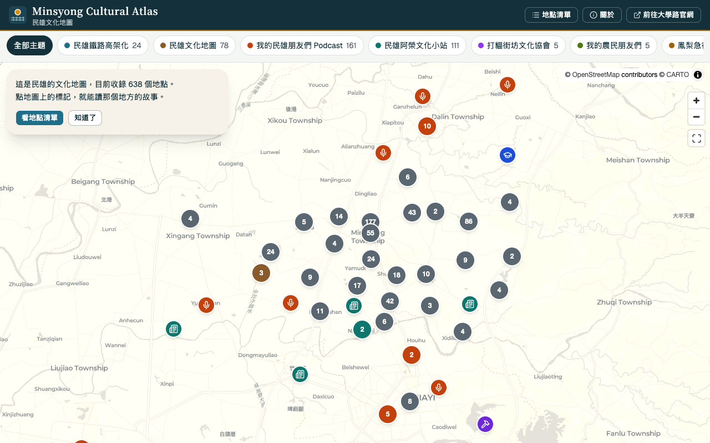
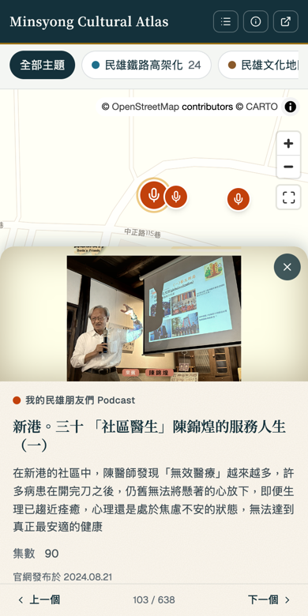

# Minsyong Cultural Atlas　民雄文化地圖

**一張可以在手機和電腦上探索的民雄文化互動地圖。**
把中正大學「重構大學路計畫」整理的民雄文史、人物、Podcast、老建築、在地報導，標在地圖上，點開就能讀每個地方的故事。

**[→ 打開地圖](https://fishpersonn.github.io/minsyong-cultural-atlas/)**

<table>
  <tr>
    <td></td>
    <td></td>
  </tr>
</table>

> *English:* an interactive map of Minxiong (民雄, Chiayi, Taiwan) cultural sites, built on public articles from National Chung Cheng University's "Reconstructing University Road" project. 638 places across 15 themes; the interface is in Traditional Chinese. Each place links back to the original article.

## 這個網站是什麼

民雄是嘉義縣的一個鄉鎮。中正大學「重構大學路計畫」多年來記錄了這裡的歷史、產業、人物與日常，文章都放在[大學路官網](https://dovoha.ccu.edu.tw/)。
文章很多、散在各處，這個網站把它們放到同一張地圖上，讓不熟悉民雄的人也能邊逛邊認識。

本站**不是**大學路官網，也不收錄文章全文：每個地點的卡片只有標題、圖片、摘要，想讀全文請點「到官網閱讀全文」前往原文。

## 可以做什麼

- **逛地圖**：標記依主題上色、換圖示；靠得近的標記會合併成數字，點下去放大；右上角的「回到全圖」鈕可以一鍵回到整體範圍。
- **篩選**：依主題（鐵路高架化、Podcast、人物、美食…）縮小範圍，主題可以複選；只選一個主題時還能再依分類篩選。地圖會自動移到結果的位置。
- **搜尋**：地圖上方的搜尋框可搜標題、內容、分類，美食還能搜地址。
- **不知道從哪看起**：「隨機一個」在目前篩選的地點裡抽一個；「我附近」用手機定位找最近的地點（需要允許位置權限）。
- **讀卡片**：封面圖、標題、摘要、年代、官網發布日期，並可用「上一個／下一個」依序逛。
- **關於**：標頭的「關於」會打開說明視窗：這張地圖是什麼、怎麼逛、資料與版權、回報問題。
- **分享**：選到的地點、主題、分類與搜尋字都會寫進網址（如 `#p=…&t=people,stele&q=…`），貼給朋友就會看到同一個畫面。
- **手機優先**：手機是底部抽屜，電腦是左側面板；支援鍵盤操作（`Esc` 關閉卡片）。

## 資料

共 **638 個地點、15 個主題**：

| 主題 | 地點數 | 主題 | 地點數 |
| --- | ---: | --- | ---: |
| 我的民雄朋友們 Podcast | 161 | 東南亞美食 | 39 |
| 民雄阿榮文化小站 | 111 | 街區走踏路線 | 36 |
| 民雄文化地圖 | 78 | 民雄鐵路高架化 | 24 |
| 民雄人物 | 75 | 工作坊紀錄 | 20 |
| 課程成果 | 49 | 鳳梨急行軍田野筆記 | 13 |
| 民雄古碑文 | 10 | 廟宇裝飾藝術 | 7 |
| 打貓街坊文化協會 | 5 | 我的農民朋友們 | 5 |
| 課程筆記 | 5 | | |

- **資料來源**：[重構大學路網站](https://dovoha.ccu.edu.tw/)（中正大學「重構大學路計畫」）。文章經爬蟲整理後，由人工標記座標與分類，**可能有錯誤或遺漏**，發現問題歡迎[開 Issue](https://github.com/fishpersonn/minsyong-cultural-atlas/issues)。
- **版權**：文章內容與圖片的版權屬大學路計畫所有。本站的圖片是**直接連到官網**顯示，沒有複製；官網改版或圖片失效時，會顯示預設圖。封面圖與發布日期是用腳本從各文章頁面補抓的（見 [docs/DATA.md](docs/DATA.md)）。
- 資料怎麼更新、格式與規則，見 [docs/DATA.md](docs/DATA.md)。

## 技術

- [Vite](https://vite.dev/) + [React](https://react.dev/) + TypeScript（`strict`）
- [Tailwind CSS](https://tailwindcss.com/) 4 + [shadcn/ui](https://ui.shadcn.com/)（Radix UI）
- [MapLibre GL JS](https://maplibre.org/)，底圖為 [CARTO](https://carto.com/) Positron
- 純靜態網站，沒有後端與資料庫；資料是隨程式一起打包的 JSON
- [Vitest](https://vitest.dev/) + Testing Library；GitHub Actions 自動檢查與部署到 GitHub Pages

沒有 WebGL 或地圖載入失敗時，會顯示提示與前往大學路官網的連結，不會是空白頁。

## 在自己的電腦上執行

需要 Node.js 22。

```bash
git clone https://github.com/fishpersonn/minsyong-cultural-atlas.git
cd minsyong-cultural-atlas
npm install
npm run dev        # 開發伺服器，網址會印在終端機（含 /minsyong-cultural-atlas/ 路徑）
```

其他指令：

```bash
npm test           # 執行測試
npm run lint       # ESLint
npm run build      # 型別檢查後打包到 dist/
npm run preview    # 預覽打包結果
```

## 專案結構

```
src/
  components/   地圖（MapView）、地點卡片、清單、篩選列、說明框…
  lib/          資料解析與驗證、篩選、標記合併、標記顏色與圖示
  data/         各主題的 GeoJSON、分類與年代補充資料、主題登錄（themes.ts）
  hooks/        網址 #p= 與選取狀態同步、說明框記憶
scripts/        import-crawler.mjs（把爬蟲專案的資料轉成本站格式）、fetch-site-meta.mjs（從官網補抓封面圖與發布日期）
docs/           DATA.md（資料維護）、截圖
```

## 部署

push 到 `main` 會由 GitHub Actions 執行 lint、測試、建置，再部署到 GitHub Pages；其他分支與 pull request 只跑檢查，不部署。
自己 fork 部署時，要在 repo 的 Settings → Pages 把 Source 設為「GitHub Actions」，並依你的 repo 名稱調整 `vite.config.ts` 的 `base`。

## 參與

發現地點座標不對、分類有誤、連結失效，或有功能建議，歡迎[開 Issue](https://github.com/fishpersonn/minsyong-cultural-atlas/issues)。
想改程式的話，請先開 Issue 討論，送 pull request 前請確認 `npm run lint`、`npm test`、`npm run build` 都通過。

## 致謝與授權

- 內容與圖片：來自[重構大學路網站](https://dovoha.ccu.edu.tw/)，版權屬大學路計畫所有。
- 地圖資料：© [OpenStreetMap](https://www.openstreetmap.org/copyright) contributors、© [CARTO](https://carto.com/attributions)（地圖角落的標註請勿移除）。
- 開源元件：MapLibre GL JS（BSD-3-Clause）、React、Vite、Tailwind CSS、shadcn/ui 與 Radix UI（MIT）、[lucide](https://lucide.dev/) 圖示（ISC）、[Noto Serif TC](https://fonts.google.com/noto/specimen/Noto+Serif+TC) 與 Geist 字體（SIL OFL）。
- **授權**：程式碼以 [MIT License](LICENSE) 授權。資料、文章內容與圖片（含 `src/data/` 底下的檔案）**不在 MIT 授權範圍內**，版權屬大學路計畫所有。
